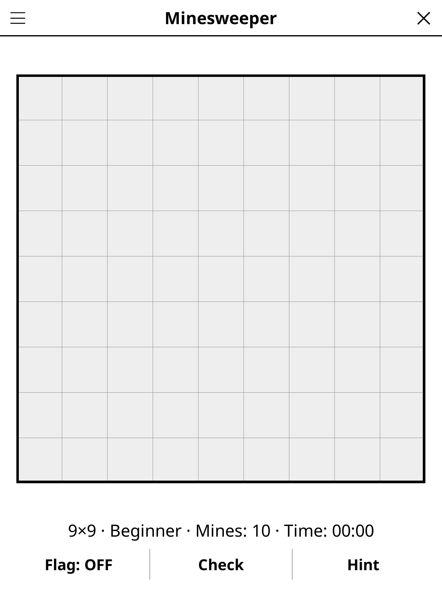

# minesweeper.koplugin

A Minesweeper plugin for [KOReader](https://github.com/koreader/koreader).

## Screenshot

## Rules

Reveal all safe cells without hitting a mine. Each revealed cell shows the count of mines in its 8 neighbours. Flag suspected mines. The first tap is always safe, and no game ever needs a guess: from the first tap, the numbers and the mine counter always tell you the next safe cell or mine.

## Concept

Uncover all safe cells on a grid without detonating any mine. Each uncovered cell
shows the count of mines in its 8 neighbouring cells. Use deduction to flag mines
and clear the board.

## Features

- **Three presets** — Beginner (9×9, 10 mines), Intermediate (16×16, 40 mines), Expert (20×16, 70 mines)
- **No guessing** — every game can be cleared by deduction alone from the first tap
- **Hint** — two taps: the first says which cell is about to give, the second acts on it
- **Safe first tap** — the first cell tapped and its neighbours are always mine-free (mines placed afterwards)
- **Auto-expand** — tapping a 0-cell reveals all adjacent safe cells recursively
- **Flag mode** — toggle between reveal and flag actions
- **Timer** — elapsed time displayed
- **Check** — tells how many safe cells are still to uncover
- **Auto-save** — in-progress game is restored on next launch

## Controls

| Action | How |
|--------|-----|
| Reveal a cell | Tap it (in reveal mode) |
| Flag / unflag a mine | Tap it (in flag mode) or long-press |
| Toggle reveal / flag mode | Tap the **Flag** button |
| New game | Tap **New game** |
| Change difficulty | Tap **Difficulty** |
| Show rules | Tap **Rules** |

## Why e-ink friendly?

Minesweeper is turn-based with no animation required. Cell states (hidden / number /
flagged / mine) map cleanly to simple glyphs renderable on any greyscale display.

## License

GPL-3.0
